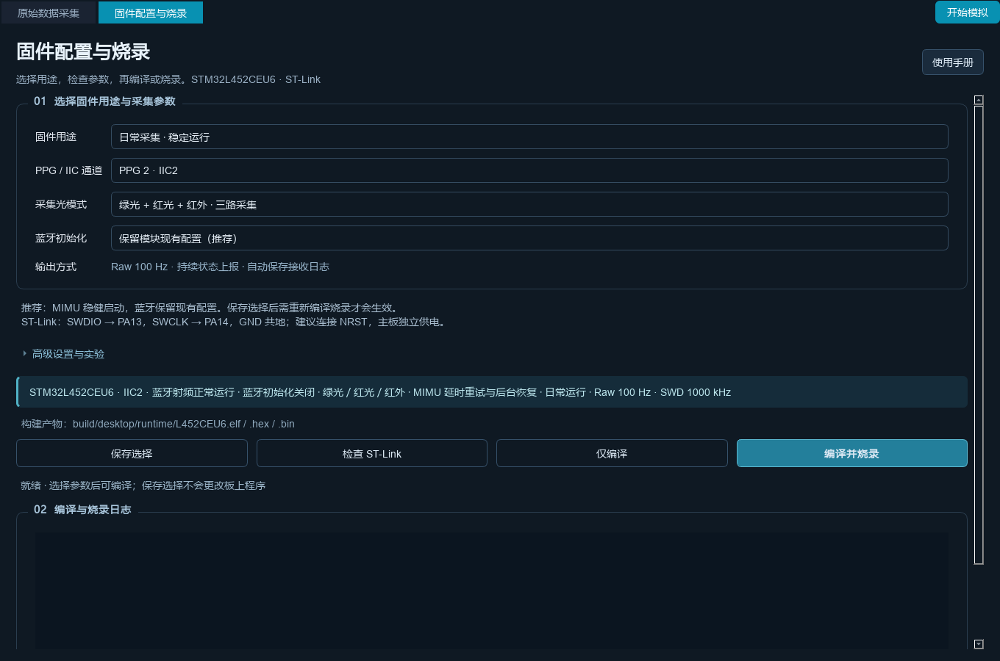

# PPG 与热膜原始数据采集系统

STM32L452CEU6 固件与 PyQt5 数据采集工作台，支持 MAX30101 三路PPG、四路热膜桥压、LSM9DS1 ACC/GYRO的同步采集、CSV录制及实时FFT心率观察。

## 快速开始（Windows）

准备64位Python **3.11**（也支持3.10/3.12），在仓库根目录执行：

```powershell
powershell -NoProfile -ExecutionPolicy Bypass -File .\scripts\setup_monitor.ps1
.\.venv\Scripts\python.exe scripts/check_environment.py --gui-smoke-test
.\.venv\Scripts\python.exe tools/monitor/main.py --raw-simulate
```

安装脚本只创建/复用项目`.venv`、安装已验证版本的依赖并运行模拟检查，不连接串口或烧录。正常使用双击 **`start.bat`**；停止模拟后再选择真实COM口连接（115200、8N1）。先填写“实验信息”，再开始录制。普通ST-Link/V2的SWD接口不提供采集串口。

实验信息分为“运动场景采集实验”和“信号性能实验”。运动录制保存在 `recordings/MMDD-SUBJECT/run1_SUBJECT_MMDD.csv`；信号性能无需填写受试者，保存在 `recordings/YYYYMMDD/huayi1_YYYYMMDD.csv`（滑移测试 token 为 `huayi`）。保存根目录可自行选择，不再自动添加 `YYYYMM-multiperson` 文件夹，原有数据不移动。完整命名与伴随文件见[原始数据录制文件结构说明](docs/acquisition/原始数据录制文件结构说明.md)。

启动器优先使用项目`.venv`，保留旧`tools/monitor/start_monitor.bat`兼容入口；可用`PPG_PYTHON`指定解释器。完整步骤见[工作台使用说明](docs/统一工作台使用说明.md)。

## 交给 agent 配置环境

可以将下面的要求直接交给读者使用的agent：

> 请在本仓库配置数据采集上位机环境。先读取AGENTS.md和docs/Agent环境配置指南.md，保留现有工作区及录制文件；使用项目虚拟环境安装依赖，运行环境检查与模拟验证，报告实际解释器路径和验证结果。只配置上位机，不自动连接真实串口或烧录。

[Agent环境配置指南](docs/Agent环境配置指南.md)给出可重复的安装、检查、故障处理及完成标准。`scripts/check_environment.py --json`提供机器可读报告。固件工具缺失不影响单独使用上位机。

## 当前功能与固件用途

- **采集**：三路PPG、热膜桥压、ACC/GYRO波形；实时FFT心率、频谱SNR及链路统计。输出固定Raw 100Hz、35字节单帧，另有STATUS v3状态包。
- **数据**：PPG界面以nA显示，CSV保留原始码值；热膜显示和保存均为原始信号，当前不做3点中值。Marker、状态和RF实验文件按需配套保存，同名录制禁止覆盖。
- **日常固件**：默认MIMU延时重试与后台恢复、保留蓝牙模块配置，详细诊断关闭；保留真实身份和配置核验。
- **新板验收**：检查MIMU A/G、ADC及可选PPG2，MAG跳过，蓝牙需人工确认。首次蓝牙配置完成后应换回日常程序。
- **诊断及实验**：详细诊断、射频复位/功率对照及双路窗口集中在折叠高级区，旧配置显式选择保留。

**不知道烧哪个版本时，先看[固件烧录与版本使用手册](docs/固件烧录与版本使用手册.md)**。烧录页右上角也能打开该手册。运行、诊断、验收产物分别位于`build/desktop/runtime/`、`diagnostic/`、`board-check/`，同一套源码通过编译参数生成；保存参数不等于已烧录。



## 开发与验证

```powershell
powershell -NoProfile -ExecutionPolicy Bypass -File .\scripts\setup_monitor.ps1 -Development
.\.venv\Scripts\python.exe -m pytest -q tests -p no:cacheprovider --basetemp build/pytest-local
```

开发依赖增加pytest、CMake、Ninja。编译还需ARM GCC；烧录另需OpenOCD、ST-Link驱动及正确供电接线，工具安装见[环境指南](docs/Agent环境配置指南.md#4-按需增加固件工具)。Clang/Node用于固件仿真测试，缺少时会跳过对应测试，报告时应区分通过和跳过。

固件页“仅编译”可生成当前用途的ELF/HEX/BIN及清单；“编译并烧录”顺序执行配置、构建、写入、校验和复位，失败即停止后续步骤。本地清单不是实板版本证明。硬件修复后已有PPG采样证据，整理版的编译/模拟结果不能代替重新烧录后的冷启动及连续采集验收。

## 目录与文档

```text
Core/                 STM32固件及传感器驱动
Drivers/              HAL、CMSIS第三方依赖
tools/monitor/        采集、协议、绘图和固件工作台
scripts/              启动、环境安装/检查、开发工具
tests/                上位机与固件仿真回归测试
docs/                 用户手册、硬件配置、开发与实验记录
```

- [文档导航](docs/README.md) · [上位机UI说明](docs/上位机UI说明文档.md)
- [固件版本与烧录用户手册](docs/固件烧录与版本使用手册.md) · [Agent环境配置指南](docs/Agent环境配置指南.md)
- [采集与CSV格式](docs/acquisition/README.md) · [硬件配置](docs/hardware/README.md)
- [新板调试收尾与经验](docs/development/新板调试收尾与经验.md) · [固件实施记录](docs/在线心率算法实施文档.md)

`.venv/`、`.local-tools/`、`build/`、`.local/logs/`及本机`config/firmware.json`不提交。原始录制位于`recordings/`，分析产物位于`reports/`；PCB工程、数据和历史实验参数不自动当作当前推荐配置。
